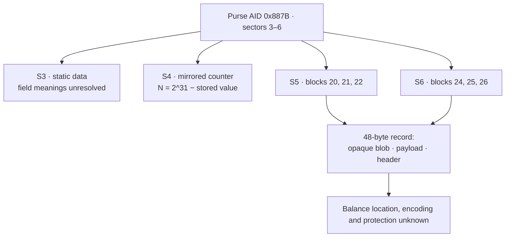

# zet-rvcard

A read-only, proof-of-concept decoder for saved dumps of Zagreb ZET
**“Vrijednosna karta”** MIFARE Classic 1K cards. The card's MIFARE Application
Directory identifies ZAGREBAČKI Holding d.o.o. and the Czech integrator
MIKROELEKTRONIKA spol. s r.o.

**Status — 2026-11-01: identity and selected metadata decode; balance and
transaction amount do not.** The stored currency/unit, numeric representation,
record-protection scheme and exclusive balance location remain unknown. Negative
format tests do not prove that reading the balance is impossible.

## Scope and evidence

`rvcard.py` reads already-acquired **1024-byte binary dumps**. It does not talk to
an NFC reader, authenticate a card, import keys, query a backend, or write to a
card. It reports:

- MAD identity, checksum validity, application sectors and holder records.
- The interpreted event counter, with complete value-block/mirror validation.
- Raw slot metadata, observed type flags and a **parity-based latest-slot guess**.
- Opaque record bytes and before/after block differences.
- Balance explicitly as **unknown**, never zero or a value copied from a receipt.

The private corpus contains **five snapshots of two cards**, captured on
2026-10-29: four states of card A and one of card B. It contains seven distinct
48-byte slot records, but only **three known transaction transitions**, all on
card A on the same day.

Evidence is not interchangeable:

- **Verified from dumps:** directory bytes/CRC, mirrored counter structure,
  transaction diffs and recurring metadata.
- **Reported observations:** terminal balances, transaction descriptions and
  historical chip-access probes. Original receipts and RF traces are not part
  of this repository.
- **Hypotheses:** date/terminal/session meanings, slot freshness outside the
  captured transitions, monetary fields, cryptographic construction and key
  location. Issuer-held cryptographic protection is plausible, not established.

The broader research included historical controlled access-condition tests on
owned cards. This published decoder provides **no card modification, cloning,
record generation, key recovery or cryptanalysis functionality**.

## Usage

Python standard library only; no dependencies.

```sh
python3 rvcard.py <dump.bin> [<dump2.bin> ...]
python3 rvcard.py --diff <before.bin> <after.bin>
python3 rvcard.py --selftest
python3 rvcard.py --selftest --dump-dir PATH
```

Recognition requires a complete image, an available MAD version 1 directory,
valid CRC, and purse AID `0x887B` on exactly sectors **3–6**. A holder label alone
is insufficient. This deliberately supports the observed layout, not every
hypothetical Zagreb card variant.

`--selftest` always runs synthetic fixtures, including malformed directories,
value/address redundancy, mirror disagreement, holder-record parsing and CLI
warnings. It additionally runs the five-dump corpus if all files are adjacent.
Otherwise it explicitly prints `REAL CORPUS: skipped`. With `--dump-dir PATH`,
the private corpus is required and a missing file fails the run. Real-corpus
checks include all three transaction block-change sets; none of these tests
establish a balance decoder or cryptographic security.

### Example: baseline snapshot

```text
========================================================================
Zagreb ZET 'Vrijednosna karta' — hf-mf-14226CDA-dump.bin
  uid:              14226CDA
  MAD:              v1 multi-app=True CRC ok=True
    sector  1: 0x0004  Card holder info (MAD std)
    sector  2: 0x0015  Card publisher info — MIKROELEKTRONIKA spol. s r.o.
    sector  3: 0x887B  ELECTRONIC PURSE — Zagreb/Mikroelektronika (HR)
    sector  4: 0x887B  ELECTRONIC PURSE — Zagreb/Mikroelektronika (HR)
    sector  5: 0x887B  ELECTRONIC PURSE — Zagreb/Mikroelektronika (HR)
    sector  6: 0x887B  ELECTRONIC PURSE — Zagreb/Mikroelektronika (HR)
    sector  7: 0x2062  Electronic ticket — Zagreb/Mikroelektronika (HR)
    sector  8: 0x2062  Electronic ticket — Zagreb/Mikroelektronika (HR)
  holder:           surname='', given name='Vrijednosna karta', other='09200901'
  event counter:    90  (mirror ok: True)
  latest record:    sector 5 (parity hypothesis)
  slot 5:        era_field=0xD405, type=top-up (0x34), session=3D2AB9
  slot 6:        era_field=0xD405, type=top-up (0x34), session=D4A9BF
  balance:          unknown — amount and currency encoding not decoded
  record blob:      5D111A2D95600D9A969F6CBB6F83AA2C  (opaque; latest slot, sector 5)
```

`record blob` is the selected slot's first block, **not a decoded balance or
identified ciphertext**. Invalid or inconsistent counter mirrors leave the
counter, latest slot and selected blob unknown; both slots' raw metadata remains
available. An unfamiliar type flag is displayed as unknown.

### Example: second top-up → fare

```text
changed blocks: [17, 18, 24, 25, 26, 28, 29, 30]
  blk 17 [event counter]: A4FFFF7F5B000080A4FFFF7F11EE11EE -> A3FFFF7F5C000080A3FFFF7F11EE11EE
  blk 18 [event counter (mirror)]: A4FFFF7F5B000080A4FFFF7F11EE11EE -> A3FFFF7F5C000080A3FFFF7F11EE11EE
  blk 24 [slot6 opaque blob]: F52DB746C0471F59F8F486B971CC2D60 -> FCE049E51949D954025EAEF24AFBD56E
  blk 25 [slot6 payload]: 8D6AA504203202EA04E02E20D4A9BF34 -> 8D6AA504203202EA04E02E208DAA2735
  blk 26 [slot6 header]: D405020000A801006D86A32DD48C42CC -> D40502E2B3D4000026A2EC8CB48E9EA7
  blk 28 [sector7 fare blk28]: 81004446063C3107A7A098DEAF3FF27D -> 81004446064431077E5BDA4ECA2460C3
  blk 29 [sector7 fare blk29]: D4A9BF3C101010101010101010400000 -> 8DAA273D101010101010101010400000
  blk 30 [sector7 fare blk30]: 0BC5000000A106405004000000000000 -> 0BBD0000005103405002000000000000

event counter:  92 -> 93  (delta +1)
latest record:  sector 6 (parity hypothesis; type=fare, session=8DAA27)
record blob:    FCE049E51949D954025EAEF24AFBD56E  (opaque — value not decoded)
```

The CLI reports the counter delta, not a proven count of genuine transactions.
A different change set or delta is not itself evidence of an illegitimate
transaction. These dumps do not reveal terminal write order.

## Animated transaction snapshots

[](update-animation.svg)

The 12-second loop shows **observed block differences**, not a universal update
procedure. Outlines mark blocks with at least one changed byte. The baseline
slot marker is inferred from parity; subsequent markers identify the slot that
actually changed. No terminal-displayed amount is presented as a decoded value.

| Card A snapshot | Interpreted N | Slot selection / evidence | Changed blocks |
|---|---:|---|---|
| Baseline | 90 | S5 inferred from parity | None; reference snapshot |
| First top-up | 91 | S6 changed | 17, 18, 24, 25, 26 |
| Second top-up | 92 | S5 changed | 17, 18, 20, 21, 22 |
| Fare | 93 | S6 changed | 17, 18, 24, 25, 26, 28, 29, 30 |

Both stored counter values decreased by one in each captured transition. All
other blocks, including trailers and sector 8, stayed unchanged. This does not
establish behavior for other transaction types or interrupted updates.

The SVG supports light/dark themes, explicit labels and a dashed fare outline.
Reduced-motion, print and non-animated rendering show the baseline; the table
above supplies all four states without motion. Opening the SVG directly permits
hover/focus to pause; an embedded README image may not expose those interactions.
Restarting the illustration does not represent a card rollback.

## Card format findings

### Directory and memory map

MAD CRC-8 uses polynomial `0x1D`, initial value `0xC7`, over block 1 bytes 1–15
and all of block 2. Both cards verify: A `B1`, B `71`; GPB is `C1` (directory
available, version 1, multi-application). **CRC validity is not cryptographic
authentication.** The AID registry associates the following applications:

| Sectors | AID | Observed content / interpretation |
|---|---|---|
| 0 | — | UID/manufacturer bytes and MAD |
| 1 | `0004` | Standard card-holder records |
| 2 | `0015` | Mikroelektronika publisher records |
| 3 | `887B` | Static purse data; issue-data interpretation provisional |
| 4 | `887B` | Mirrored event-counter candidate, blocks 17/18 |
| 5–6 | `887B` | Alternating 48-byte records |
| 7–8 | `2062` | E-ticket data; tokens correspond to S6/S5 respectively |
| B only: 9 | `1837` | Prepaid coupon |
| B only: 10 | `071D` | Customer profile |
| A: 9–15; B: 11–15 | free | Zero data blocks, transport keys |

Each sector has four 16-byte blocks; its fourth block is the trailer. Across
the captured card-A states all 16 trailers are unchanged. Keys differ between
cards and are shared across application-sector groups; the derivation algorithm
and provisioning time are unknown.

### Interpreted event counter

Blocks 17 and 18 are identical MIFARE value blocks with value/inverse/value
redundancy and repeated/complemented address bytes. **Both use address `0x11`**;
the redundant address need not equal the physical block number.

```text
 A4 FF FF 7F | 5B 00 00 80 | A4 FF FF 7F | 11 EE 11 EE
 value LE     inverse       repeated       address redundancy

 stored value = 0x7FFFFFA4
 N = 2^31 − stored value = 92
```

This interpretation gives A: 90/91/92/93 and B: 169. The three transitions
support an event-related counter rather than a direct monetary balance.
The initial count and lifetime transaction-count meaning remain unestablished.

Sector-4 access bits deny direct writes and increments on blocks 17/18 but allow
read/decrement/transfer/restore with either key. Trailer 19 denies key/access-bit
changes. Historical card-A probes reported enforcement of direct-write/increment
and trailer-write restrictions; this decoder does not repeat those probes.
These permissions alone establish neither exactly-one transaction updates nor
unconditional anti-rollback or backend rejection guarantees.

### Record slots and metadata



| Record region | Observation |
|---|---|
| First block, 16 bytes | Opaque; changes at every captured write to that slot |
| Payload bytes 4–5 | Raw `20 32` in new records, `D4 05` in older records |
| Payload bytes 12–14 | Token preserved by both top-ups; S6 changes at the fare |
| Payload byte 15 | `34` for the two captured top-ups, `35` for the captured fare |
| Header bytes 0–2 | `D4 05 02` in all seven distinct records |
| Header bytes 3–7 | Raw bytes; writer/time/line interpretations are unverified |
| Header bytes 8–15 | Opaque; change at every captured transaction |

“Era/date,” “session token” and “writer data” are descriptive names, not decoded
semantics. A 2004-04-05 date epoch was chosen to fit one date; no observed daily
progression establishes it. The type labels also rest on a small sample.

S6 payload bytes 0–11 are identical at the first top-up and the fare despite
different reported balances. They cannot alone encode a deterministic current
balance for those observations. **That does not exclude the rest of the payload,
the header tail, the blob, or a combination.** The balance has not been isolated
to a single region.

Slot parity (odd → S6, even → S5) agrees with the three observed writes. Applying
it to the baseline or card B is inference; card B has no captured transition to
verify freshness. The reader labels that selection as a hypothesis.

### Sector 7: observed fare changes

At the one captured fare:

- Block 28 byte **5** changes `3C → 44`, as well as bytes **8–15**.
- Block 29 bytes 0–3 change `D4A9BF3C → 8DAA273D`; its first three bytes track
  the S6 payload token.
- Block 30 changes offsets 1, 5, 6 and 9: `C5→BD`, `A1→51`, `06→03`, `04→02`.
  `C5→BD` is 197→189, **not halving**. Field boundaries and meanings are unknown.

Sector 7 was unchanged at both captured top-ups; this does not mean kiosks never
update it. Sector 8 remained unchanged in this sequence.

## Balance research: results and limits

### Displayed amounts are not decoded values

| Card A snapshot | Reported terminal balance | Reported transaction |
|---|---:|---|
| First top-up | EUR 36.34 | Top-up amount unknown |
| Second top-up | EUR 41.34 | Top-up EUR 5.00 |
| Fare | EUR 40.81 | Fare display EUR 0.53 |

These reports label the samples; the dump bytes do not independently verify them.
The stored unit could be EUR, euro cents, HRK or lipa, and its representation
could be fixed-point, floating, split or protected. The historical 4-HRK tariff
is compatible with EUR 0.53; it does not prove an on-card debit of 400 lipa.

If integer lipa are converted at 7.5345 HRK/EUR and rounded half-up to the nearest
cent, EUR 36.34 permits **27377–27384 lipa**, EUR 41.34 permits **31144–31151**,
and EUR 40.81 permits **30745–30752**. EUR 5.00 converts to 3767.25 lipa before
rounding. The earlier single converted numbers are not known plaintext.

### What has been tested

The offline experiments use the three known-display snapshots. The local probe
scripts check their SHA-256 hashes before assigning these reported balances.
These scripts and private fixtures live in the separate research workspace,
**not this standalone reader repository**.

| Experiment | Outcome and scope |
|---|---|
| Integer/BCD/floating fields | No consistent candidate in the tested widths, bit orders and unit models |
| Split/reordered fields and scales | No candidate for the bounded split fields, whole/fraction pairs, scattered digits, scales or rounding models |
| Derived balance and per-slot tests | No candidate for tested two-field sums/differences, cross-slot arithmetic or S6-only layouts |
| FareBot numerical recipes | 29 variants plus bit-relocated half-cent and either-slot tests; no match |
| MOBIB-inspired patterns | Version-selected contract-price field and nine-counter sum; no match in the one-off offline checks |

The reusable local probes are `balance_probe.py`, `balance_layout_probe.py` and
`farebot_balance_probe.py`; their synthetic controls pass. A random two-state
control produced two apparent shared-offset fits, illustrating why matching two
balances does not establish a decoder. There is no independent new transaction
on which to validate a discovered rule, and no validated rule emerged.

The seven distinct first-block blobs have one aligned equal byte across 21
pairs (random expectation 1.3125). That is compatible with cryptographic mixing,
not proof of a cipher, key size, external key storage or fresh keys per event.
Historical key/algorithm candidate tests were also unsuccessful; their negative
results depend on assumed layouts and monetary values. They are not exhaustive
proofs and are not shipped or rerun by this reader.

### Related projects: what transfers and what does not

- **[FareBot](https://github.com/codebutler/farebot/tree/dc09f6f014ea3675b64bcd38335b4b78d77fa374):**
  inspected balance implementations at the pinned revision, not just recognition
  tests. Useful patterns include signed packed fields, biases, CharlieCard's
  half-cent truncation, RKF divisors and duplicate-record selection. Numerical
  adaptations were tested; the full app was not built/run. No generic RV record
  decoder was found. Some supported cards, such as Myki, expose only a serial.
- **[flipper-mobib](https://github.com/i12bp8/flipper-mobib/tree/886a2a634991ee93b6b8b03ec711163b3ffb2b0a):**
  Calypso contract prices and version/presence-bit layouts, not a demonstrated
  RV purse decoder. A field may move between layouts; arbitrary per-sample
  offsets would nevertheless overfit our small corpus.
- **[mobib-extractor](https://github.com/zoobab/mobib-extractor/tree/a59983f5aa119ad3b48086c61c25bc4d8a03adba):**
  sums nine big-endian 24-bit counters for remaining journeys, not money.
- **[navegante-reader](https://github.com/hmiguel/navegante-reader/tree/8793f829a26589fe00e562aacc5756023765da93):**
  reads Calypso records and uploads them to an external decoding API. The actual
  decoder is absent from that repository. Its example separates counter units
  from counter values; no RV data was uploaded and the application was not run.
- **[Glasgow ticket study](https://github.com/fork-bombed/spt-decoded):**
  useful collection/differential-analysis methodology, including date progression,
  terminal IDs and different ticket layouts. It decodes journeys, not an RV
  monetary purse, and does not supply a signature-breaking algorithm.

### What remains unresolved

No test establishes the balance's exclusive location, algorithm, key material,
record authentication coverage, or terminal/backend policy. A 16-byte blob need
not be one 128-bit cipher block. Changing bytes do not imply changing keys.
The record may combine multiple fields or use a grammar not tested so far.

Before/after/amount semantics and a bounded version/presence-bitmap grammar are
possible follow-up hypotheses, **not completed or successful decodes**. More
same-slot/same-type observations, another date/card, or an approved format
specification would provide more discriminating evidence than unconstrained
searches over the same three amounts.

ZET's [official FAQ](https://www.zet.hr/preuzimanja/odredbe/najcesca-pitanja/391)
describes an **“i” balance inquiry** on onboard devices and balance checks at
sales points. No before/after inquiry dumps or RF trace have been collected in
this corpus. A permitted passive trace could identify requested blocks and any
card-side updates; removing Crypto1 transport encryption would expose stored
bytes, not necessarily decode protection inside those bytes. Do not assume the
inquiry writes nothing, that the displayed amount travels over NFC, or that a
trace will reveal a terminal secret. Current tools remain saved-dump-only.

## FareBot integration status

This repository contains **no Kotlin module, FareBot fork or live-card reader**.
Upstream FareBot source has been inspected, but no RV integration has been
compiled or verified. A contribution can currently expose identity and metadata,
not a decoded balance. Unknown monetary values must remain unknown.

Live access is a separate requirement: the Python reader needs no keys because
it consumes a dump; an NFC implementation must authenticate the necessary
sectors with card-specific keys. The public MAD authentication key does not
thereby unlock the purse. No key-derivation method is known here.

## Private data and testing

The real-corpus filenames are `hf-mf-14226CDA-{dump,topup,topup2,fare1}.bin` and
`hf-mf-5ED82083-dump.bin`. They are not committed. BIN files, key-BIN files and
JSON exports are excluded by `.gitignore`; JSON exports can contain authentication
keys. Do not upload private dumps to third-party decoding services.

Synthetic tests run from a clean checkout. Use `--selftest --dump-dir PATH` for
required real-corpus validation. Historical RF/chip behavior and cryptographic
hypotheses are not verified by these assertions. The published example record
bytes are not authentication keys or usable balance-decoding rules.

## License

MIT — see [LICENSE](LICENSE). Related projects retain their respective licenses;
reviewing their algorithms does not import their source code into this reader.
