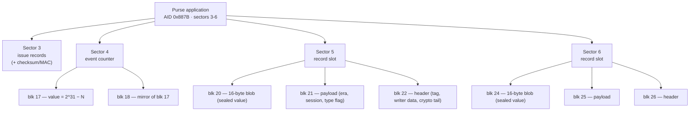
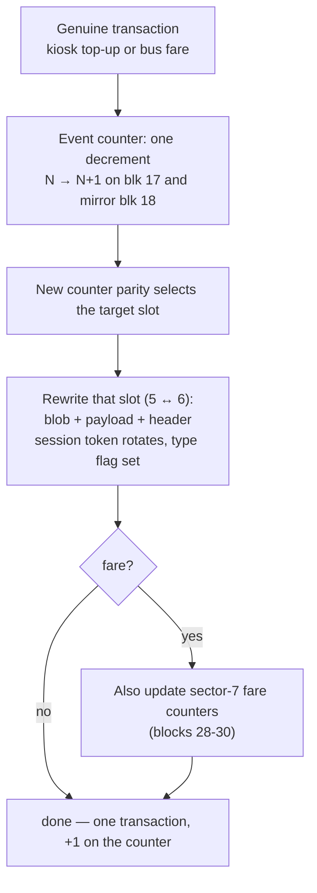

# zet-rvcard

Reverse-engineering of the Zagreb ZET **"Vrijednosna karta"** (value card) — a
MIFARE Classic 1K transit purse issued by ZAGREBAČKI Holding d.o.o. /
MIKROELEKTRONIKA spol. s r.o. (SK). `rvcard.py` is the proof-of-concept
decoder for the card format, with every finding validated by `--selftest`
against values independently verified on live cards (chip reads plus
before/after dumps of known transactions).

## Scope

This project documents only the **plaintext data structure** of the card — the
MIFARE Application Directory, the event counter, the record-slot layout, the
transaction type flags, and the raw (undecoded) metadata fields. It is
interoperability and format research, carried out on the author's own cards by
read-only analysis.

It does **not**:

- **decode or disclose the encrypted payload.** The 16-byte record blob (which
  holds the balance and transaction amounts) stays sealed under an issuer-held
  key. Its plaintext contents are unknown and are not revealed anywhere here;
  the tool only points at the ciphertext, never inside it.
- **attempt to break that encryption.** No key recovery, no cryptanalysis of
  the payload, is pursued or published. (Independent analysis indicates a
  card-side break is not feasible in any case — the key lives off-card.)
- **modify the card in any way.** No top-up or balance forgery, no purse
  tampering, no event-counter manipulation, no record rewriting, and no card
  emulation or cloning. Every finding comes from reading dumps, never writing.

In short: this describes how the card is laid out, not what the sealed values
are and not how to change them.

## Usage

```sh
python3 rvcard.py <dump.bin> [<dump2.bin> ...]       # decode one or more dumps
python3 rvcard.py --diff <before.bin> <after.bin>    # interpret one transaction
python3 rvcard.py --selftest                         # run the assertion suite
```

Dumps are raw 1024-byte MIFARE Classic 1K images (e.g. Proxmark3
`hf mf dump` output). Stdlib only — no dependencies.

Example output (baseline dump of card A, event counter at 90):

```
========================================================================
Zagreb ZET 'Vrijednosna karta' — hf-mf-14226CDA-dump.bin
  uid:              14226CDA
  MAD:              v1 multi-app=True CRC ok=True
    sector  1: 0x0004  Card holder info (MAD std)
    sector  2: 0x0015  Card publisher info — MIKROELEKTRONIKA spol.s.v.o.
    sector  3: 0x887B  ELECTRONIC PURSE — Zagreb/Mikroelektronika (HR)
    sector  4: 0x887B  ELECTRONIC PURSE — Zagreb/Mikroelektronika (HR)
    sector  5: 0x887B  ELECTRONIC PURSE — Zagreb/Mikroelektronika (HR)
    sector  6: 0x887B  ELECTRONIC PURSE — Zagreb/Mikroelektronika (HR)
    sector  7: 0x2062  Electronic ticket — Zagreb/Mikroelektronika (HR)
    sector  8: 0x2062  Electronic ticket — Zagreb/Mikroelektronika (HR)
  holder:           surname='', given name='Vrijednosna karta', other='09200901'
  event counter:    90  (mirror ok: True)
  latest record:    sector 5 (parity)
  slot 5:        era_field=0xD405, type=top-up (0x34), session=3D2AB9
  slot 6:        era_field=0xD405, type=top-up (0x34), session=D4A9BF
  balance:          encrypted — not readable card-side
  balance blob:     5D111A2D95600D9A969F6CBB6F83AA2C  (latest slot, sector 5)
```

`--diff` reproduces the before/after method every finding here came from. A
genuine transaction touches only the event counter and one record slot (plus
the sector-7 counters, for fares); anything else changing would be a red flag.
Comparing the second top-up to the following bus fare:

```
changed blocks: [17, 18, 24, 25, 26, 28, 29, 30]
  blk 17 [event counter]: A4FFFF7F5B000080A4FFFF7F11EE11EE -> A3FFFF7F5C000080A3FFFF7F11EE11EE
  blk 18 [event counter (mirror)]: A4FFFF7F5B000080A4FFFF7F11EE11EE -> A3FFFF7F5C000080A3FFFF7F11EE11EE
  blk 24 [slot6 blob (value)]: F52DB746C0471F59F8F486B971CC2D60 -> FCE049E51949D954025EAEF24AFBD56E
  blk 25 [slot6 payload]: 8D6AA504203202EA04E02E20D4A9BF34 -> 8D6AA504203202EA04E02E208DAA2735
  blk 26 [slot6 header]: D405020000A801006D86A32DD48C42CC -> D40502E2B3D4000026A2EC8CB48E9EA7
  blk 28 [sector7 fare blk28]: 81004446063C3107A7A098DEAF3FF27D -> 81004446064431077E5BDA4ECA2460C3
  blk 29 [sector7 fare blk29]: D4A9BF3C101010101010101010400000 -> 8DAA273D101010101010101010400000
  blk 30 [sector7 fare blk30]: 0BC5000000A106405004000000000000 -> 0BBD0000005103405002000000000000

event counter:  92 -> 93  (delta +1  ONE transaction, as expected)
new record:     sector 6 (type=fare, session=8DAA27)
balance blob:   FCE049E51949D954025EAEF24AFBD56E  (encrypted — value sealed)
```

## Card format findings

### MAD identification (NXP AN10787)

The card carries a MIFARE Application Directory in sector 0. The decoder
verifies the MAD CRC-8 (poly `0x1D`, init `0xC7`), lists the AID registered on
each sector, and parses the card-holder-info RLC records (sector 1, AID
`0x0004`) — surname / given name / sex / other.

Registered applications of interest (AID → meaning):

| AID | Application |
|-----|-------------|
| `0x0015` | Card publisher info — MIKROELEKTRONIKA spol.s.v.o. |
| `0x071D` | Customer profile — Zagreb/Mikroelektronika (HR) |
| `0x1837` | Prepaid coupon — Zagreb/Mikroelektronika (HR) |
| `0x2062` | Electronic ticket — Zagreb/Mikroelektronika (HR) |
| `0x887B` | **Electronic purse** — Zagreb/Mikroelektronika (HR), registered 01.04.2009 |

### Purse application (AID `0x887B`, sectors 3–6)

- **Sector 3** — issue records (per-card issue data with a trailing
  checksum/MAC); not decoded further.
- **Hardware event counter** — sector 4, blocks 17/18, mirrored Mifare value
  blocks. The stored value is `2^31 − N` where `N` counts every genuine
  transaction (fare or top-up). The chip denies write and increment for all
  keys and only accepts the decrement that records the next transaction,
  so `N` only ever rises — it cannot be rolled back.
- **Rotating record slots** — sectors 5/6, three blocks each:
  `[16-byte encrypted blob][payload block][header block]`. The blob holds
  amount/balance/event under the issuer's key and is **not** readable; the
  payload block carries readable metadata (era/date field, session token,
  transaction type flag).
- **Era/date field** — payload bytes 4–5: `0x2032` in every record written
  on 2026-10-29, by the kiosk **and** the bus validator alike; `0xD405` in
  the card's older records. Leading hypothesis: a date counter (days since
  2004-04-05) — but date counter vs. system-era marker is an open question,
  so the decoder reports the raw value instead of naming an era.
- **Transaction type flag** — payload byte 15: `0x34` = top-up,
  `0x35` = fare.
- **Slot rotation** — the latest transaction alternates between sectors 5/6
  with the event counter's parity (parity hypothesis: counter odd → latest
  record in sector 6; holds on all observed states across two cards).
- **Balance** — encrypted in the record blob; the balance never appears in
  plaintext anywhere on the card, in any byte encoding or any card state. The
  blob is indistinguishable from a proper block cipher / 128-bit MAC under an
  issuer-held key (no plaintext, no keystream reuse, no per-position leak), so
  the decoder can point at the current-balance ciphertext (`balance blob`, the
  latest slot's 16 bytes) but cannot decode it without the issuer key.

## Layout and update diagrams

Same findings as above, drawn out. Mermaid renders on GitHub/GitLab; the ASCII
versions are for plain-text viewers. Everything here is the plaintext layout and
the read-only before/after behaviour — no sealed values, no write recipes.

### Whole-card memory map

MIFARE Classic 1K is a fixed grid: 16 sectors × 4 blocks = 64 blocks = 1024 bytes.
Each sector's last block is its trailer (keys A/B + access bits).

```
 Sector  Blocks           AID       Role
 ─────────────────────────────────────────────────────────────────────
   0      0   1   2  [ 3]  —         UID + manufacturer, MAD directory
   1      4   5   6  [ 7]  0x0004    Card-holder info (RLC: name, sex, …)
   2      8   9  10  [11]  0x0015    Card publisher — MIKROELEKTRONIKA
   3     12  13  14  [15]  0x887B    Purse: issue records
   4     16  17  18  [19]  0x887B    Purse: event counter (value blocks)
   5     20  21  22  [23]  0x887B    Purse: record slot
   6     24  25  26  [27]  0x887B    Purse: record slot
   7     28  29  30  [31]  0x2062    E-ticket: fare counters / slot-6 index
   8     32  33  34  [35]  0x2062    E-ticket: slot-5 index
  9-15   36 ……………… 63      varies    Coupon / profile (card B) or unused
 ─────────────────────────────────────────────────────────────────────
   [n] = sector trailer      Purse application = sectors 3–6 (AID 0x887B)
```

### Purse application structure (AID `0x887B`)



### Event counter (sector 4, blocks 17 & 18)

Two identical MIFARE value blocks. The chip refuses write and increment for every
key and only accepts the one decrement that logs the next transaction, so `N` is
monotonic — a one-way, anti-rollback counter. It counts transactions; it is not a
balance.

```
 blk 17 = blk 18 :
   A4 FF FF 7F | 5B 00 00 80 | A4 FF FF 7F | 11 EE 11 EE
   └ value LE ┘ └ ~value   ┘ └ value LE ┘ └ 0x11 ~ 0x11 ~ ┘
      value = 0x7FFFFFA4 = 2^31 − 92        addr = block 17 (0x11)
                              └─ N = 92

   Each transaction: exactly one decrement (N → N+1),
   e.g. value 0x7FFFFFA4 → 0x7FFFFFA3  ⇒  N 92 → 93.
```

### Record slot (sectors 5 and 6, 3 blocks = 48 bytes)

The card keeps the last two transactions, one per slot. Only the payload block is
readable metadata; the blob is sealed and the header's tail is per-transaction
crypto.

```
 ┌──────────────────────────────────────────────────────────────┐
 │ blk +0  BLOB      16 bytes  SEALED under issuer key            │ amount /
 │                   holds amount · balance · event              │ balance /
 │                   not readable card-side, in any encoding      │ event live
 ├──────────────────────────────────────────────────────────────┤ here — and
 │ blk +1  PAYLOAD   readable metadata                           │ nowhere in
 │   [0]      era marker                                          │ plaintext
 │   [1-2]    slot constant                                       │
 │   [3-11]   era + slot constants (fixed per slot / era)         │
 │   [4-5]      era/date field  0x2032 (2026-10-29) · 0xD405 old  │
 │   [12-14]  session token      (rotates on every write)         │
 │   [15]     type flag          0x34 top-up · 0x35 fare          │
 ├──────────────────────────────────────────────────────────────┤
 │ blk +2  HEADER                                                │
 │   [0-2]    tag           D4 05 02                              │
 │   [3-7]    writer data   kiosk/validator id · time?           │
 │   [8-15]   per-transaction crypto tail                        │
 └──────────────────────────────────────────────────────────────┘
   slot in sector 5 → blocks 20·21·22      slot in sector 6 → 24·25·26
```

### Slot rotation

The newest record alternates between the two slots with the event counter's
parity, so the card always holds exactly the last two transactions.

```
 counter N   parity   newest slot   older slot
 ───────────────────────────────────────────────
   91         odd          6             5
   92         even         5             6
   93         odd          6             5
 ───────────────────────────────────────────────
 Rule (hypothesis, holds on all observed states, both cards):
   odd  → newest in sector 6
   even → newest in sector 5
```

### What one genuine transaction changes

The before/after method behind every finding. A legitimate transaction touches
only the counter and the newly written slot — plus the sector-7 fare counters for
a fare. Anything else changing would be a red flag.




## Test data

`--selftest` asserts against five reference dumps
(`hf-mf-14226CDA-{dump,topup,topup2,fare1}.bin`, `hf-mf-5ED82083-dump.bin`)
captured from two cards — a morning baseline and before/after dumps of two
kiosk top-ups and one bus fare. The dump files contain personal card data and
are **not** committed to this repository; the selftest requires them next to
`rvcard.py`.

## License

MIT — see [LICENSE](LICENSE).
